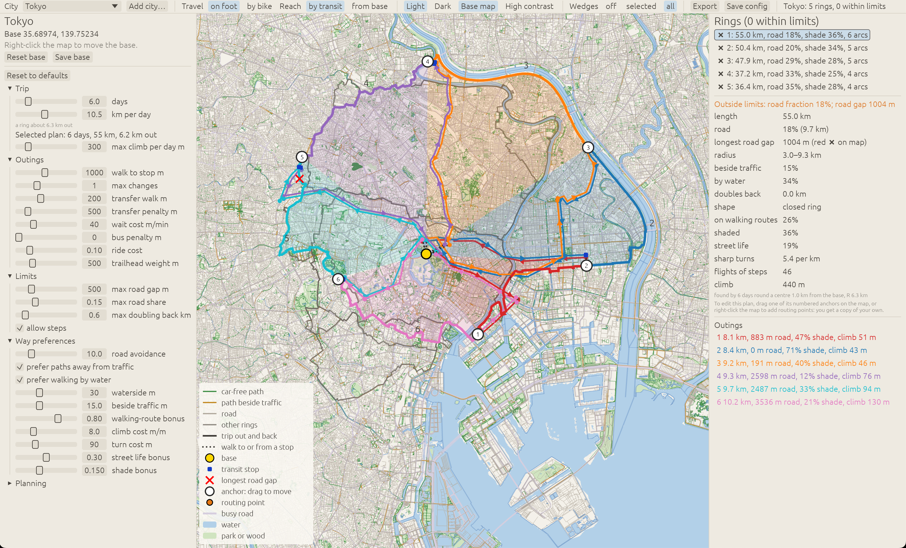
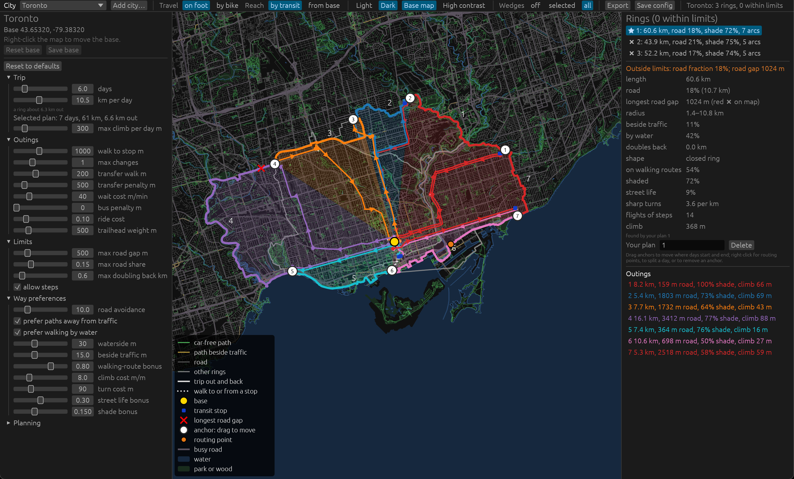

# Wedgewalks

<a href="doc/tokyo.png"></a>
<a href="doc/toronto.png"></a>

## LLM notice

This repo was written by an LLM.

## Overview

This is a custom mapping tool for interactively planning trips with
specific constraints:

  1. Start and end each day in the same place, typically downtown in some city,
     but adjustable to wherever you happen to be.
  2. Each day's trip picks up where the last one ended, and forms a circuit
     roughly around the base point.
  3. No car: selectable mix of foot, bike or transit.
  4. Prioritize nice things to walk or bike on: parks, paths, shores, ravines,
     shady and quiet places with lower traffic, interesting pedestrian
     neighbourhoods, etc.

We refer to these circuits as "wedgewalks" because each trip is a wedge of a
circular path, like slices of a pie or segments of a wheel.

There are options to do the whole wedge on foot, or on bike, as well as the
option in each case to _take transit_ out to the edge of the circuit each way,
rather than walking or biking out.

You can scale up or down the number of days or length of each wedge depending
on your ambition. Different transit modes obviously cover more space.

The planner extracts transit routes, bike paths, walking paths, traffic density,
walkable neighbourhoods and so forth from public data sources. It might be wrong!
You can adjust a path by dragging the points or adding secondary routing points.

## Why?

They are intended to give a sense of challenge, progress and completion, and
seeing an interesting cross section of a region, while providing some advantages
over more common linear itineraries:

  1. They allow remaining in-or-around dense transit networks, or dense
     cycle or pedestrian networks, for people who can't or don't want to
     drive.
  2. By starting and stopping in the same place, they minimize the need
     for continuity. You can do a wedgewalk over an extended period of
     time and take breaks without worrying about being stranded.
  3. They also simplify accommodation planning. You do not need to book
     lots of separate places to stay.


## Use

```sh
cargo run --release                      # interactive planner (GUI)
```

In the GUI:
- **Cities**: pick one, or *Add city…* by name or from the GaWC world-city list;
  maps download in the background (BBBike city extracts where they exist,
  otherwise Geofabrik regions; downloads resume).
- **Trip**: days and km per day. **Travel** is a 2×2: on foot or by bike, and
  by transit or from the base. Each combination keeps its own trip.
- **Plans**: each is listed with its problems if outside the limits (road share,
  road gap, doubling back, climb); limits re-rank instantly, other settings re-plan.
- **Edit by hand**: drag anchors, add and move routing points; edits are routed
  like any plan and saved per city in `edits/<city>.json`.
- **Export**: printable `itinerary.html`, GPX per day, GeoJSON and `report.txt`.

## Known limitations

- Dense cities exceed the 15% road limit in places (Vancouver ~23%).
- Watery, sparse towns (Nanaimo) may double back or fall short of the days.
- Walking from the base: walks out and home may run along the arc.
- Bikes are assumed able to use transit anywhere; there are no timetables
  (frequency only where OSM has `interval`).
- Where the map ends before the ring does, the ring follows the data edge and
  the days come out fewer.

## Downloads

Binaries for Linux, macOS (Apple silicon and Intel) and Windows are attached to each
[release](../../releases): unpack and run `wedgewalks` (on macOS, open `Wedgewalks.app`). With no options it keeps `config.toml`,
`cities.csv`, `data/`, `edits/` and `out/` in the current directory if that has a `cities.csv`,
otherwise in a per-user folder (`~/Library/Application Support/wedgewalks`, `%APPDATA%\wedgewalks`
or `~/.local/share/wedgewalks`), created on first run. The binaries are unsigned: on macOS,
right-click the app and choose Open (or `xattr -dr com.apple.quarantine Wedgewalks.app`); on Windows,
choose "More info", then "Run anyway". Linux needs X11 or Wayland and OpenGL.

Releases are built by `.github/workflows/release.yml` when a tag like `v0.1.0` is pushed.

## License

MIT; see [LICENSE](LICENSE). Map data is from OpenStreetMap contributors (ODbL).
